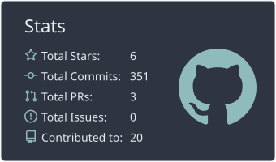
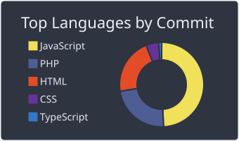

<!-- =====================================================
     1) BANNIÈRE ANIMÉE (fichier assets/header.svg)
     ===================================================== -->

  

<!-- =====================================================
     2) TEXTE QUI S'ÉCRIT TOUT SEUL
     Dans cette URL : pas d'accents, pas d'emojis, pas
     d'apostrophes. Les espaces s'écrivent "+".
     ===================================================== -->

  

 

<!-- =====================================================
     3) BOUTONS EN NUANCES DE BLEU (shields.io)
     ===================================================== -->

  
  
  
  

 

<!-- =====================================================
     4) COMPTEUR DE VUES (komarev)
     ===================================================== -->

  

 

<!-- =====================================================
     5) MENU DE NAVIGATION
     "## About" crée #about, "## Tech Stack" crée #tech-stack,
     "## GitHub Stats" crée #github-stats, "## Contact" crée #contact
     ===================================================== -->

  <a href="#about">About</a> ·
  <a href="#tech-stack">Tech Stack</a> ·
  <a href="#github-stats">Stats</a> ·
  <a href="#contact">Contact</a>

 

<!-- =====================================================
     6) SÉPARATEUR BLEU (fichier assets/divider.svg)
     ===================================================== -->

<!-- =====================================================
     SECTION "ABOUT"
     RAPPEL : aucune balise ni texte ne doit commencer par
     des espaces dans ce tableau (il contient du Markdown
     avec des lignes vides, sinon : bloc de code).
     ===================================================== -->
## About

<table>
<tr>
<td width="60%" valign="top">

**Marino AÏDOMOAN: Full-Stack Web Developer & Trainer**, passionate about building **modern, responsive and scalable** digital solutions, with a strong focus on clean architecture and a great user experience.

Student in **Software and Information Systems (SIL)** at **UATM / GASA Formation** in Porto-Novo, Benin. I put my skills into practice through real projects, from web development to software engineering and networking.

I am also part of **M2J TECHNOLOGY**, an initiative that trains people in web development across Africa, where I help design learning materials.

</td>
<td width="40%" valign="top">

**🔷 Areas of expertise**

- Web Development
- Software Engineering
- Database Management
- Networking
- Programming (C, C++, Java, Python, PHP)
- Web Training & Teaching

</td>
</tr>
</table>

 

<!-- =====================================================
     SECTION "TECH STACK" (tableau centré)
     ===================================================== -->
## Tech Stack

  <table align="center">
    <tr>
      <!-- ===== EN-TÊTES DES COLONNES ===== -->
      <th align="center">Frontend</th>
      <th align="center">Backend &amp; Languages</th>
      <th align="center">Databases</th>
      <th align="center">Tools &amp; Infra</th>
    </tr>
    <tr>
      <!-- ===== COLONNE 1 : FRONTEND ===== -->
      <td align="center" valign="top">
        
      </td>
      <!-- ===== COLONNE 2 : BACKEND & LANGAGES ===== -->
      <td align="center" valign="top">
        
      </td>
      <!-- ===== COLONNE 3 : BASES DE DONNÉES ===== -->
      <td align="center" valign="top">
        
      </td>
      <!-- ===== COLONNE 4 : OUTILS & INFRA ===== -->
      <td align="center" valign="top">
        
      </td>
    </tr>
  </table>

<!-- =====================================================
     BADGES pour les outils sans icône (dont Fedora)
     ===================================================== -->

  
  
  
  
  
  
  

 

<!-- =====================================================
     SECTION "GITHUB STATS"
     Les 2 premières cartes viennent de ton workflow
     (.github/workflows/profile-cards.yml). Elles apparaissent
     APRÈS la première exécution du workflow.
     ===================================================== -->
## GitHub Stats

  
  

 

<!-- Carte "streak" : série de jours de contributions -->

  

 

<!-- =====================================================
     ÉTAPE 5 : SECTION "CONTACT"
     - Email    : le lien "mailto:" ouvre l'application mail
     - Couleurs : nuances de bleu (comme le reste du profil)
     ===================================================== -->
## Contact

  
  
  

 

<!-- =====================================================
     PIED DE PAGE : vague bleue animée (fichier assets/footer.svg)
     ===================================================== -->

  

